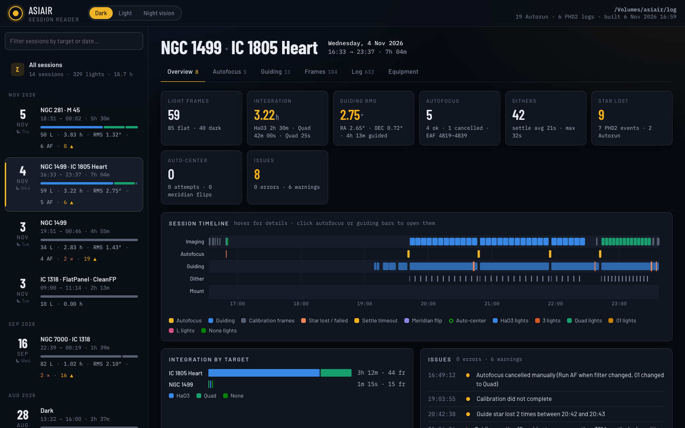
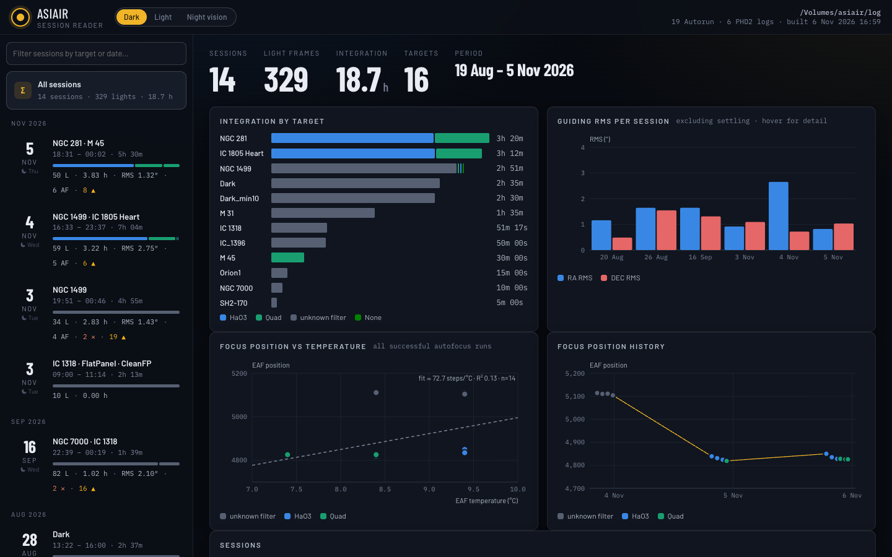
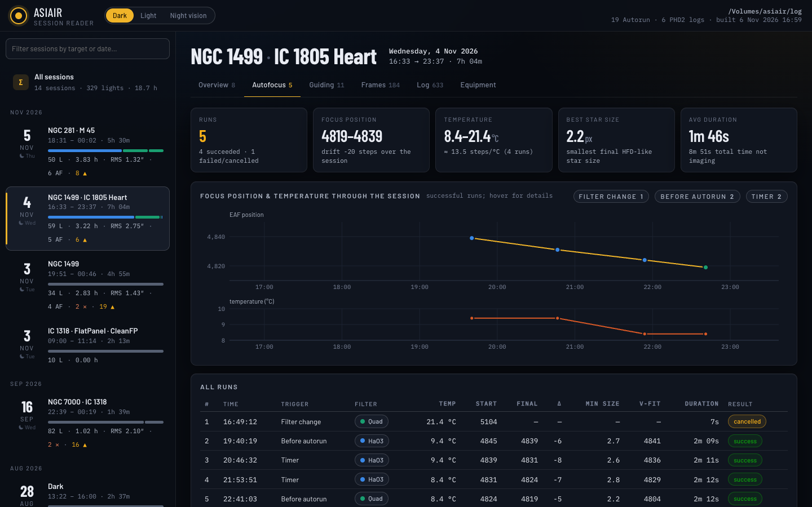
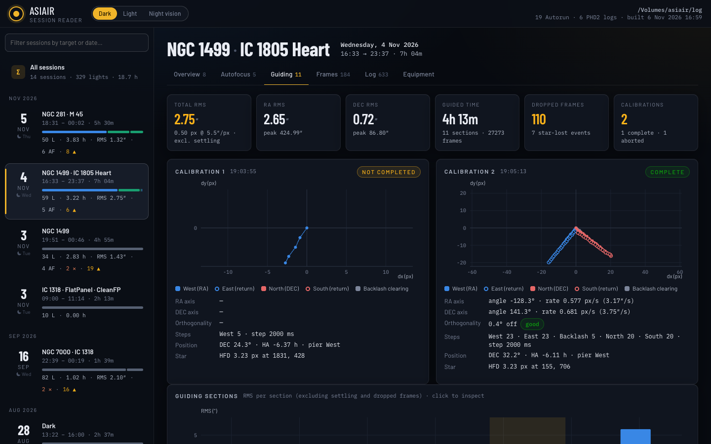
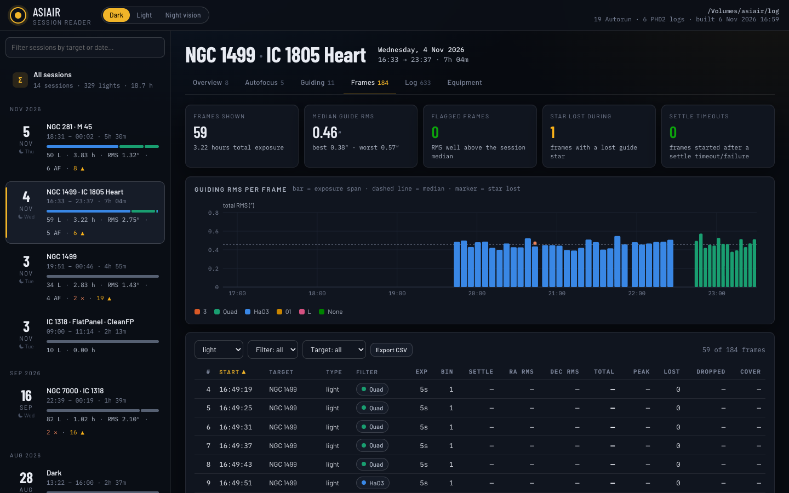
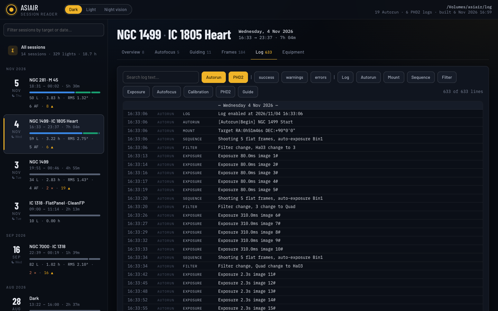
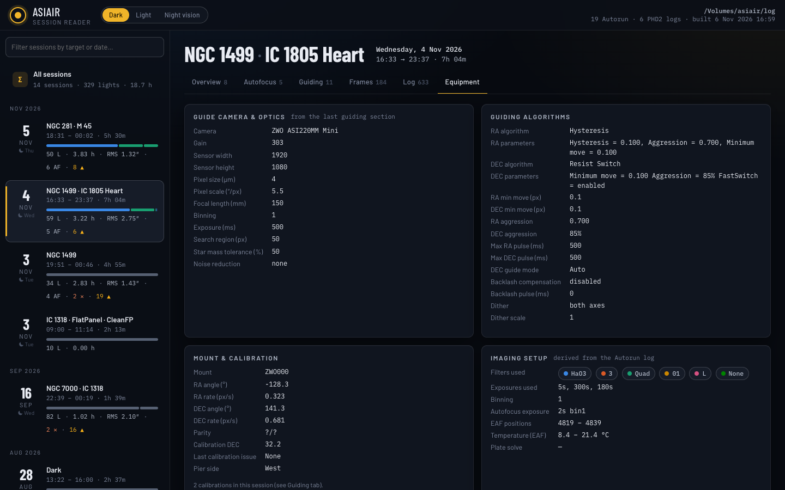

# ASIAIR Log Reader

Turns the Autorun and PHD2 guide logs that a ZWO ASIAIR writes into a
self-contained web page: one night per session, with the autofocus runs,
guiding quality, every exposure, a merged event log and the equipment settings.

Pure Python 3, standard library only. Nothing to `pip install`.



## Requirements

* Python 3.9 or newer (`python3 --version` to check).
* Read access to the ASIAIR's `log` folder, either over the network share the
  ASIAIR exposes, or a copy of that folder on your computer.

## Install

Clone the repository (or download it as a ZIP from GitHub and unpack it):

```bash
git clone https://github.com/grebleem/ASIairLogReader.git
cd ASIairLogReader
```

That is the whole install. To update later, run `git pull` in the same folder.

### Mounting the ASIAIR share

The ASIAIR shares its storage over SMB while it is powered on and on your
network. Connect to it so the `log` folder is visible to your computer:

* **macOS**: Finder → Go → Connect to Server, enter `smb://<asiair-ip>`
  and connect as Guest. The share appears under `/Volumes/asiair`.
* **Windows**: in Explorer, open `\\<asiair-ip>` and use the share from there,
  or map it to a drive letter.
* **Linux**: `sudo mount -t cifs //<asiair-ip>/asiair /mnt/asiair -o guest`
  (or use your file manager's network browser).

The ASIAIR's IP address is shown in the ASIAIR app under the device settings.
Alternatively, copy the `log` folder to your computer and point the script at
the copy.

## Usage

```bash
python3 asiair_logs.py /Volumes/asiair/log
```

That scans the directory, writes `output/index.html` and opens it in your
browser. On Windows the path looks like `\\<asiair-ip>\asiair\log` or
`Z:\log`. When no directory is given, `/Volumes/asiair/log` is assumed.

| Option | Meaning |
|---|---|
| `-o DIR` | output directory (default `./output`) |
| `--gap-hours N` | idle gap that separates two sessions (default 5) |
| `--json` | also write `output/data.json` with the parsed data |
| `--no-open` | do not open the browser |
| `--serve [PORT]` | serve the output over HTTP on localhost (default port 8765) |
| `--quiet` | less console output |

Examples:

```bash
# build the page and serve it at http://localhost:8765
python3 asiair_logs.py /Volumes/asiair/log --serve

# work from a local copy of the logs, keep the parsed data as JSON
python3 asiair_logs.py ~/asiair-logs --json --no-open
```

The page is a single HTML file with the data embedded, so it works offline and
can be copied anywhere. It loads its fonts from Google Fonts when online and
falls back to system fonts otherwise.

## What it reads

* `Autorun_Log_*.txt` (the English version; `_CHN` duplicates are skipped):
  plans, autorun runs, capture sequences, every exposure, filter changes,
  autofocus runs with their V-curve samples, auto-center / plate-solve attempts,
  meridian flips, dither and settle events, guide-star loss.
* `PHD2_GuideLog_*.txt`: calibrations (every step, angles, rates,
  orthogonality) and guiding sections with every guide frame, settling windows,
  dithers and dropped frames.

Logs are grouped into sessions by time: anything separated by less than the gap
(5 hours by default) belongs to the same session, so a night that crosses
midnight stays together and a daytime flat/dark run is its own session.

## What the page shows

* **All sessions**: integration per target and filter, guiding RMS per session,
  focus position vs EAF temperature (with a steps/°C fit), focus history.
* **Overview**: KPI tiles, a timeline of imaging / autofocus / guiding / dither /
  mount activity, integration per target, detected issues, runs and sequences.
* **Autofocus**: every run with its V-curve (samples, approach steps, chosen
  position, a two-line V fit), focus position and temperature trend.
* **Guiding**: calibration plots, RMS per guiding section, and for the selected
  section the RA/DEC error trace, guide pulses, SNR / star mass, RA-vs-DEC
  scatter and error histogram. RMS values exclude settling, dropped frames and
  "runaway" frames (star more than 30″ from the lock position for 3+ frames,
  which is the guider following a drifting or wrong star, not guiding error);
  those are counted and flagged separately.
* **Frames**: every exposure with the guiding RMS measured during that exposure,
  settle time before it, star-loss events and dropped guide frames. Sortable,
  filterable, exportable to CSV.
* **Log**: the merged Autorun + PHD2 event stream with search and filters.
* **Equipment**: guider, algorithm and mount settings, and anything that changed
  between guiding sections.

Themes: dark, light and a red night-vision mode (top right).

## Screenshots

**All sessions**: integration per target, guiding RMS per night, focus vs temperature.



**Autofocus**: focus position and EAF temperature through the night, every run with its V-curve.



**Guiding**: calibrations, RMS per guiding section, and the error trace of the selected section.



**Frames**: every exposure with the guiding RMS measured during it.



**Log** and **Equipment**: the merged Autorun + PHD2 event stream, and the guider and mount settings.





## Troubleshooting

* `error: ... is not a directory`: the share is not mounted or the path is
  wrong. Check that the ASIAIR is on and reachable, then mount it again.
* No sessions found: the directory must contain `Autorun_Log_*.txt` and/or
  `PHD2_GuideLog_*.txt` files directly, not in a subfolder.
* The page is large (several MB for a season of logs). Use `-o` to write it
  somewhere else, or `--gap-hours` to tune how logs are split into sessions.

## Layout

```
asiair_logs.py            command-line entry point
asiairlog/
  autorun.py              Autorun log parser + session model builder
  phd2.py                 PHD2 guide log parser + per-section statistics
  sessions.py             discovery, session grouping, Autorun/PHD2 correlation, summaries, issues
  report.py               builds the single-file HTML
  util.py                 shared helpers
  templates/app.{html,css,js}   the viewer
```

## License

MIT, see [LICENSE](LICENSE).
